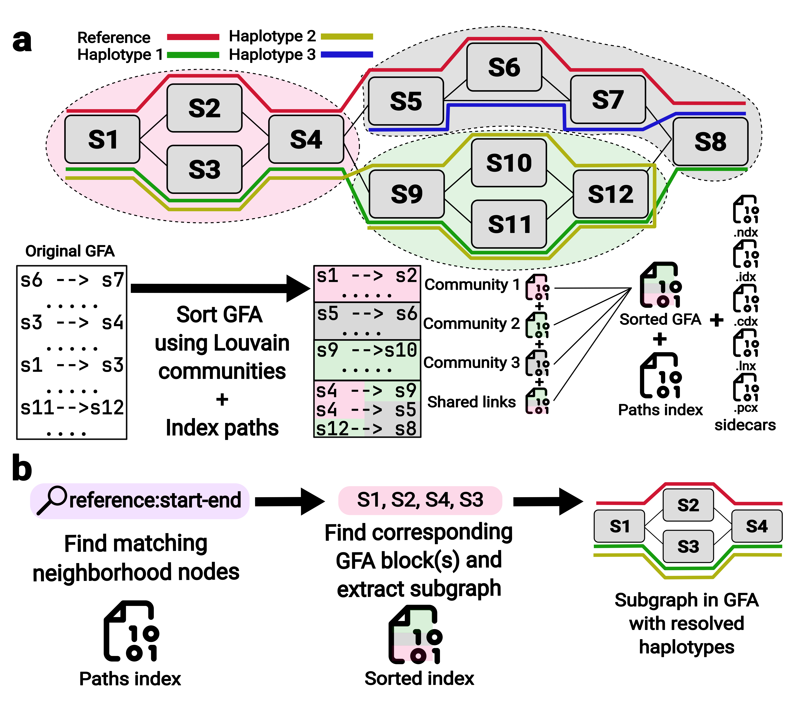

# gfaidx

gfaidx indexes genome graphs in [GFA](https://github.com/GFA-spec/GFA-spec)
format so that any part of a graph can be read quickly, without loading the
whole graph into memory. It splits the graph into communities of densely
connected nodes, writes each community as its own block of a gzip file, and
builds small index files to find nodes, paths and genomic coordinates. A query
then decompresses only the blocks it needs.

gfaidx works with pangenome graphs that have `P` or `W` lines (for example
from PGGB or Minigraph-Cactus), with rGFA (minigraph), and with graphs without
paths, such as assembly graphs.



**(a)** Indexing. gfaidx finds communities in the graph with Louvain community
detection (colors) and rewrites the GFA so that each community's segments and
links form one gzip block. Links between communities go into a final shared
block. Small sidecar files map every node to its block (`.ndx`, `.idx`) and
store node lengths (`.lnx`) and, optionally, reference coordinates (`.cdx`).
If the graph has `P` or `W` lines, they are stored in a separate path index
(`.pdx`, with coordinate checkpoints in `.pcx`).
**(b)** A region query. gfaidx finds the nodes of `reference:start-end` through
the path index, decompresses only the blocks that hold them, and writes the
subgraph with the haplotypes that pass through it.

## Contents

- [Installation](#installation)
- [Index a graph](#index-a-graph)
- [Query a region](#query-a-region)
- [Extract a neighborhood](#extract-a-neighborhood)
- [Other commands](#other-commands)
- [C++ and Python libraries](#c-and-python-libraries)
- [Documentation](#documentation)
- [Citation](#citation)
- [License](#license)

## Installation

gfaidx runs on Linux and macOS.

### Bioconda

```bash
conda install -c conda-forge -c bioconda gfaidx
```

### Prebuilt binaries

Every [release](https://github.com/fawaz-dabbaghieh/gfaidx/releases) has
ready-to-run binaries:

| System | Archive |
|---|---|
| Linux x86-64 | `gfaidx-<version>-linux-x86_64.tar.gz` |
| Linux ARM64 | `gfaidx-<version>-linux-aarch64.tar.gz` |
| macOS Intel | `gfaidx-<version>-macos-x86_64.tar.gz` |
| macOS Apple silicon | `gfaidx-<version>-macos-arm64.tar.gz` |

```bash
tar -xzf gfaidx-v2.3.2-linux-x86_64.tar.gz
./gfaidx --version
```

The Linux binaries are statically linked and run on any distribution.
`index_gfa` uses the system `sort` command, which is part of GNU coreutils on
Linux; on Alpine Linux, install it with `apk add coreutils`.

### From source

Building needs a C++17 compiler, CMake 3.20 or newer, and zlib.

```bash
git clone https://github.com/fawaz-dabbaghieh/gfaidx.git
cd gfaidx
cmake -S . -B build -DCMAKE_BUILD_TYPE=Release
cmake --build build -j 4
cmake --install build --prefix ~/.local    # optional
```

## Index a graph

The same command indexes every kind of GFA 1 graph, plain or gzipped:

```bash
gfaidx index_gfa graph.gfa.gz graph.indexed.gfa.gz
```

This writes the indexed graph `graph.gfa.gz` and its sidecar files beside it:
`.idx`, `.ndx`, `.lnx`, `.pdx`, `.pcx` and a `.params` summary of the run.
Keep them together; the query commands find them by name.
It can also take uncompressed gfa, but the output is a multi-member gzip file.

Useful options:

- `--threads N` builds the path index with `N` threads.
- `--tmp_dir DIR` puts temporary files in `DIR` instead of beside the input.
  Path indexing needs about 12 bytes of temporary space per path step, for
  example 54 GB for the 4.5 billion steps of the HPRC PGGB chromosome 1 graph.
- `--max_chunk_nodes N` splits communities larger than `N` nodes, so queries decompress smaller blocks.
- `--min_chunk_nodes N` merge communities smaller than `N` nodes, so not too many communities need to be decompressed

What else is needed depends on the kind of graph:

### A graph without paths

An assembly graph, for example, has only `S` and `L` lines. Index it and query
it from a node with [`get_subgraph`](#extract-a-neighborhood):

```bash
gfaidx index_gfa assembly.gfa.gz assembly.indexed.gfa.gz
gfaidx get_subgraph assembly.indexed.gfa.gz utg000123 neighborhood.gfa --max_nodes 500
```

### A pangenome with `W` lines (Minigraph-Cactus)

`W` lines carry their own coordinates, so region queries work right after
indexing. A coordinate index (`.cdx`) for the reference makes them faster:

```bash
gfaidx index_gfa hprc.gfa.gz hprc.indexed.gfa.gz --threads 8 --tmp_dir /scratch
gfaidx index_coordinates hprc.indexed.gfa.gz hprc.indexed.gfa.gz.cdx --reference CHM13
```

`--reference` selects one of the reference samples listed in the GFA header's
`RS:Z` tag; without it, all of them are indexed. `index_gfa` never overwrites
an existing file, so give the indexed graph a different name from a gzipped
input.

### A pangenome with `P` lines (PGGB)

`P` line names such as `CHM13#0#chr1` are queried directly, and a name ending
in `:start-end` gives that path's position. To store coordinates for the
reference paths, list the paths, keep the ones you need, and index those:

```bash
gfaidx index_gfa pggb.gfa.gz pggb.indexed.gfa.gz --threads 8
gfaidx get_path pggb.indexed.gfa.gz --print_path_names > paths.tsv
# filtering for paths with CHM13 in their name
awk -F '\t' '$1 == "P" && $2 ~ /^CHM13#/' paths.tsv > reference_paths.tsv
gfaidx index_coordinates pggb.indexed.gfa.gz pggb.indexed.gfa.gz.cdx --path_names_file reference_paths.tsv
```

### An rGFA (minigraph)

An rGFA stores reference positions in the `SN`, `SO` and `SR` tags of its `S`
lines. Region queries on an rGFA need the coordinate index, which picks up the
`SR:i:0` segments automatically:

```bash
gfaidx index_gfa minigraph.gfa.gz minigraph.indxed.gfa.gz
gfaidx index_coordinates minigraph.indxed.gfa.gz minigraph.indxed.gfa.gz.cdx
```

See [coordinates.md](docs/coordinates.md) for how coordinates work in each
kind of graph.

## Query a region

```bash
gfaidx get_region <graph.indexed.gfa.gz> <sequence:start-end> <out.gfa> [options]
```

`get_region` writes the part of the graph that covers a genomic interval as an
ordinary GFA: the `S` and `L` lines of the selected nodes, followed by the
pieces of every `P` or `W` path inside them. Coordinates are 0-based and
half-open, as in BED files. The sequence is the `W` lines' sequence name (with
`--reference` for the sample), the `P` path name without any `:start-end`
suffix, or the rGFA `SN` name.

`--mode` chooses which part of the graph is returned:

- `all` (default) returns every haplotype through the interval. gfaidx takes
  the reference nodes inside the interval, finds every path that passes
  through them, and keeps each path from its first to its last of those nodes,
  including insertions and other sequence that is not in the reference. In
  repeats, a path can pass through those nodes at distant places;
  `--haplotype_gap 10kb` then splits it wherever more than 10 kb of the path
  lies between two of them, and leaves out the sequence in between.
- `reference` returns the nodes within `--context` bases of the interval
  (default 100) and only the reference path, like `gbz-base query
  --reference-only`.
- `bfs` returns the graph around the interval, up to `--max_nodes` nodes or
  within `--context` bases, with every path piece inside it.

`--with_coords` gives each returned path piece its own coordinates: start and
end on `W` lines, and a `:start-end` suffix on `P` names.

```bash
# Every haplotype through 100 kb of CHM13 chr22, with coordinates
gfaidx get_region hprc.indexed.gfa.gz chr22:20000000-20100000 region.gfa \
  --reference CHM13 --with_coords

# The same, but split a haplotype where more than 10 kb separates two reference nodes
gfaidx get_region hprc.indexed.gfa.gz chr22:20000000-20100000 region.gfa \
  --reference CHM13 --with_coords --haplotype_gap 10kb

# Only the reference path, with 1 kb of graph context on each side
gfaidx get_region hprc.indexed.gfa.gz chr22:20000000-20100000 reference.gfa \
  --reference CHM13 --mode reference --context 1kb

# A PGGB graph: the P path name is the sequence
gfaidx get_region pggb.indexed.gfa.gz CHM13#0#chr1:1000000-1100000 region.gfa --with_coords

# An rGFA: the graph around the interval, up to 5,000 nodes
gfaidx get_region minigraph.indexed.gfa.gz chr1:1000000-1100000 region.gfa \
  --mode bfs --max_nodes 5000

# List every sequence that can be queried, and its range
gfaidx get_region hprc.indexed.gfa.gz --list_coordinates
```

## Extract a neighborhood

```bash
gfaidx get_subgraph <graph.indexed.gfa.gz> <node_id> <out.gfa> [options]
```

`get_subgraph` starts from one node and adds its neighbors, then theirs, in
both directions along the links, until it has `--max_nodes` nodes (default
100). It writes those nodes, the links between them, and the pieces of every
`P` or `W` path inside them.

```bash
# 2,000 nodes around node 12345
gfaidx get_subgraph graph.indexed.gfa.gz 12345 neighborhood.gfa --max_nodes 2000

# The same, with coordinates on the path pieces
gfaidx get_subgraph graph.indexed.gfa.gz 12345 neighborhood.gfa --max_nodes 2000 --with_coords

# Nodes and links only, without paths
gfaidx get_subgraph graph.indexed.gfa.gz 12345 neighborhood.gfa --max_nodes 2000 --no_paths
```

## Other commands

| Command | What it does |
|---|---|
| `index_coordinates` | Build the `.cdx` coordinate index for selected reference paths or rGFA segments. |
| `get_path` | List all paths, print a whole path, or print the path pieces inside a set of nodes. |
| `get_chunk` | Print one community block of the indexed graph. |
| `index_paths` | Rebuild only the `.pdx` path index. |
| `index_path_checkpoints` | Build the `.pcx` checkpoints for an index that lacks them. |

Every command and option is described in the
[command reference](docs/cli_reference.md).

## C++ and Python libraries

The same query engine is available as a C++ library and as the Python package
`pygfaidx`. Both open an existing index and return subgraphs, paths and
regions as in-memory graphs, or stream them line by line:

```python
import pygfaidx

index = pygfaidx.IndexedGraph("graph.indexed.gfa.gz")
graph = index.get_subgraph(["12345"], max_nodes=1000)
graph.write_gfa("neighborhood.gfa")
```

Indexes are built with the `gfaidx` command-line tool. See
[README_pygfaidx.md](README_pygfaidx.md) for installing and using the Python
package, and [README_library.md](README_library.md) for the C++ library. The
[BubbleGun example](python/examples/bubblegun/README.md) runs bubble detection
on a whole chromosome graph community by community, in a fraction of the
memory.

## Documentation

- [Command reference](docs/cli_reference.md): every command and option
- [Coordinates](docs/coordinates.md): region queries on `W`-line, `P`-line and
  rGFA graphs
- [How gfaidx works](docs/how_it_works.md): the indexing steps, the index
  files, and how queries use them
- [Python package](README_pygfaidx.md) and [C++ library](README_library.md)
- [Helper scripts](scripts/README.md)
- [Making a release](docs/releasing.md)

## Citation

A paper describing gfaidx is in preparation. Until it is published, please
cite this repository: <https://github.com/fawaz-dabbaghieh/gfaidx>.

## License

gfaidx is released under the [MIT License](LICENSE).
